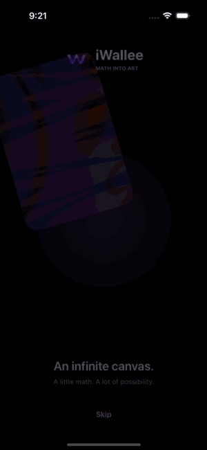
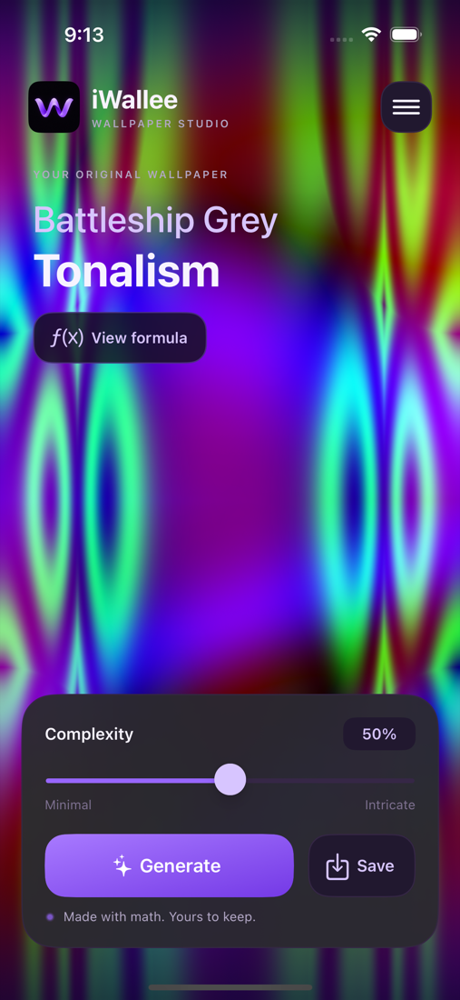
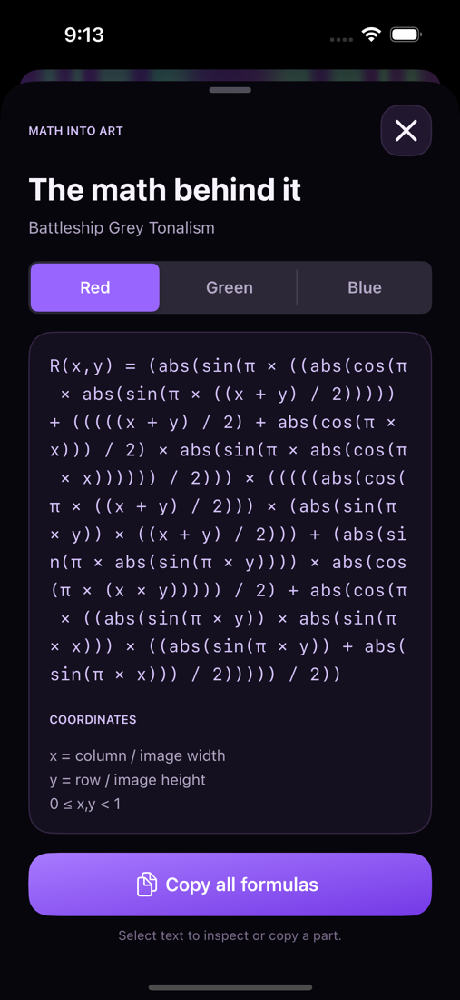
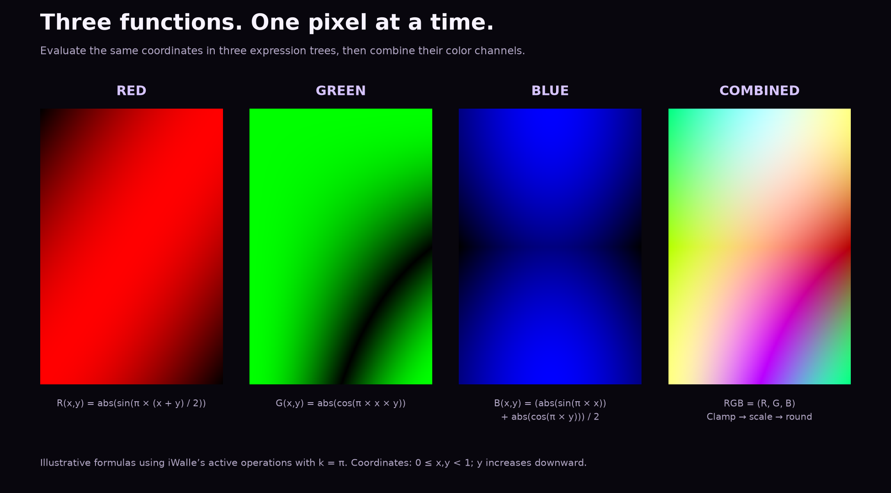
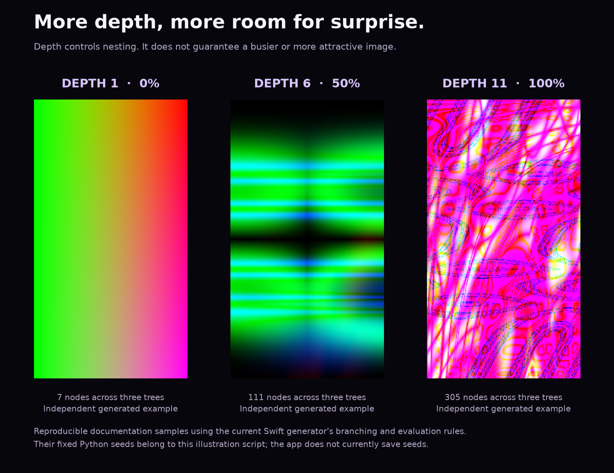
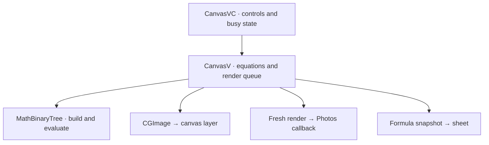
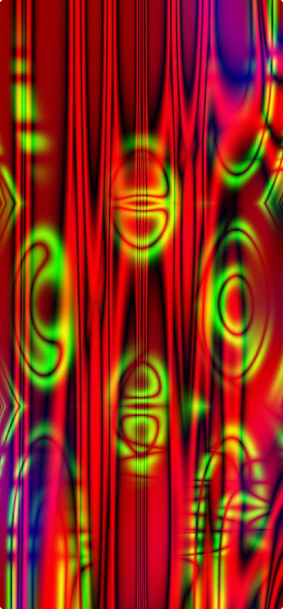
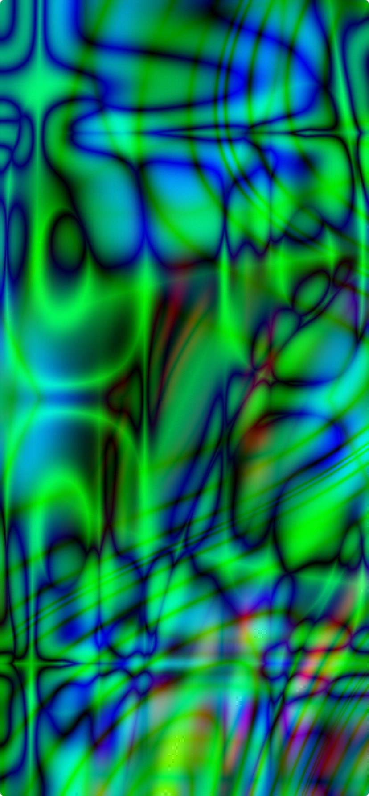
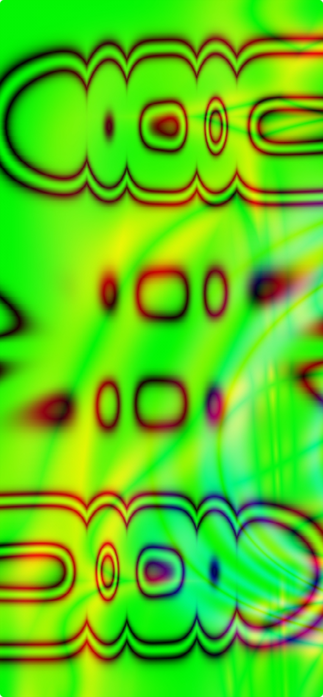
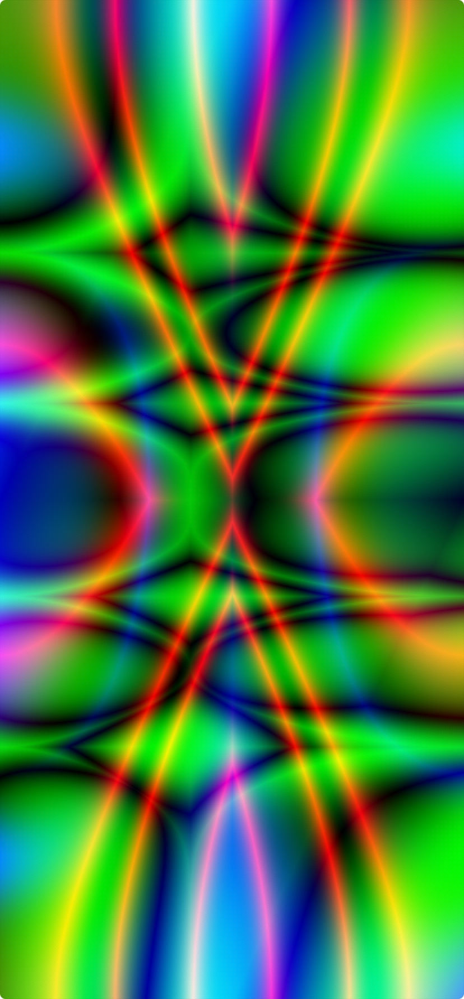

<p align="center">
  
</p>

<h1 align="center">iWallee</h1>

<p align="center"><strong>A wallpaper studio where every color comes from an equation.</strong></p>

<p align="center">Swift · UIKit · Recursive expression trees · Offline rendering</p>

iWallee turns randomly assembled mathematical expressions into colorful iPhone wallpapers. Each image has three functions: one for red, one for green, and one for blue. Evaluate them across a canvas and an abstract composition appears—sometimes a soft gradient, sometimes a field of waves, sometimes a dense pattern.

The project began when **Ronald Guerra** adapted a classroom exercise he enjoyed into an iOS app. Its repository history begins in August 2020. The product name is **iWallee**; the repository is `wally`, while the Xcode workspace, scheme, and module still use **RandomArt**.

## A look inside

<p align="center">
  
  
  
</p>

The opening sequence uses four existing wallpapers, arriving one at a time as a stack of cards. It runs once when a scene opens, lasts about **1.6 seconds**, and offers **Skip**. Reduce Motion uses a static stack with a short fade. It is a brief introduction; generation and saving have their own activity states.

### What you can do

- **Generate** a new wallpaper from three random expression trees.
- **Adjust complexity** from depth 1 to 11 before the next generation.
- **Inspect the math** with the formula sheet's Red, Green, and Blue tabs, then copy all three formulas.
- **Save a fresh render** at 1170 pixels wide, using the same equations as the preview.
- **Browse 70 bundled wallpapers**, filter the collection, and preview a favorite.

The studio keeps Generate, Save, the slider, and the formula button unavailable during a generation or save operation. The purple/black interface and dark shading belong to the preview; exported artwork contains the generated pixels without those controls or overlays.

## How math becomes an image



For a pixel at column `c` and row `r` in a `W × H` image:

1. Normalize its position: `x = c / W`, `y = r / H`.
2. Evaluate the same `(x, y)` in the red, green, and blue trees.
3. Convert each result into an 8-bit color channel: `round(255 × clamp(value, 0, 1))`.
4. Write those three bytes and an opaque alpha byte into the image.

The current generator chooses among **multiplication, average, absolute sine, and absolute cosine**. Their recursive combinations create the picture. There is no training step or image-generation service: the app computes the colors locally.

The illustration above uses deliberately chosen formulas so you can follow the process. For example, its red channel is `abs(sin(π × (x + y) / 2))`. The [algorithm guide](docs/algorithm.md) walks through its expression tree and a single pixel, then explains the app's exact generation rules.

### What “complexity” means



The slider changes **expression depth**, the number of nested operation levels. Deeper expressions allow more combinations and usually cost more to evaluate. They do not guarantee a more detailed or more attractive image: random choices can still produce a quiet composition. These examples were reproduced with the app's branching and evaluation rules; their fixed Python seeds belong only to the documentation script.

## Where the idea comes from

This project belongs to the **Random Art** tradition of making images from mathematical expressions. The exact source of Ronald's classroom exercise has not been recovered, so the following is a documented lineage of related work, rather than a claim about his professor's handout.

| Work | Connection to the idea |
| --- | --- |
| [Karl Sims, *Artificial Evolution for Computer Graphics* (1991)](https://www.karlsims.com/papers/siggraph91-backup.html) and [*Genetic Images* (1993)](https://www.karlsims.com/genetic-images.html) | Symbolic expressions generated pictures; selection and evolution produced new generations. iWallee does not implement that evolutionary process. |
| [UC San Diego CSE 130, Random Art assignment (2005)](https://cseweb.ucsd.edu/classes/fa05/cse130/pa1/pa1.html) | A classroom exercise used coordinate leaves and recursive multiplication, average, sine, and cosine—very close to the educational pattern in this project. |
| [Christopher A. Stone, Nifty Assignments: Random Art (2009)](https://nifty.stanford.edu/2009/stone-random-art/) | An approachable teaching assignment using recursive expressions and RGB images. It explicitly credits Andrej Bauer's Random Art as inspiration. |
| [Andrej Bauer's Random Art](https://www.random-art.org/about/) and [Python tutorial (2010)](https://math.andrej.com/2010/04/21/random-art-in-python/) | A public generator and an explanation of how randomly built expressions become images. Bauer's named generator uses the name as a seed; iWallee currently does not. |

There are real differences between implementations. Several teaching versions use coordinates and outputs in `[-1, 1]`; iWallee samples coordinates in `[0, 1)`, uses absolute trigonometric results, and generates three separate trees. Its wallpaper name is assigned afterward and does not reproduce the image. See [history and implementation differences](docs/algorithm.md#history-and-implementation-differences) for details and original sources.

## Architecture

The app uses **UIKit with MVC-inspired responsibilities**. Controllers coordinate screens and user actions, expression trees represent the mathematics, and `CanvasV` owns the render queue and current equations. Storyboards still identify controllers, while the refreshed screens build their visible layouts in `loadView()`.



Pixel work runs on a serial background queue. UI changes and completion handling return to the main queue. Preview, export, and formula display use the **same three expression trees**, so the formula sheet explains the artwork you are looking at. Busy state remains active through the actual Photos callback when saving.

Read the [architecture guide](docs/architecture.md) for ownership, scene lifecycle, cached navigation, the generation/save state diagram, and persistence boundaries.

## Run it locally

You need a Mac with Xcode and CocoaPods installed. The development setup was verified with **Xcode 26.2**, **CocoaPods 1.16.2**, and an **iPhone 16 simulator running iOS 18.5**. The app targets iOS 13.0 and uses Swift 5 language mode.

```sh
git clone https://github.com/raguerraa/wally.git
cd wally
pod install --deployment
open RandomArt.xcworkspace
```

Choose the **RandomArt** scheme and an installed iPhone simulator, then press **Command-R**. Open the workspace so Xcode can see the CocoaPods targets. Xcode does not install Pods automatically.

The lockfile pins **NVActivityIndicatorView 5.1.1** and **SideMenuSwift 2.0.9**. The [development guide](docs/development.md) includes simulator test commands, dependency troubleshooting, and the files to edit for colors, animation timing, formulas, and export size.

## Documentation map

| Guide | What you will learn |
| --- | --- |
| [Algorithm and history](docs/algorithm.md) | Expression trees, coordinate mapping, all operations, a worked pixel, depth/cost, and historical context. |
| [Architecture](docs/architecture.md) | Component ownership, rendering, busy states, Photos callbacks, formula consistency, lifecycle, and data storage. |
| [Development](docs/development.md) | Setup, tests, dependency fixes, common changes, and contribution workflow. |
| [Figure source](scripts/render_doc_illustrations.py) | How the RGB and depth illustrations are generated; optional Python tooling, separate from the iOS app. |

### Current boundaries

Generated equations stay in memory while the app runs. The app does not yet save their seeds or serialize them for replay, and the bundled gallery does not store the original formulas for its images. Saving writes an image to Photos. Rendering uses the CPU and has no cancellation or GPU renderer. These are useful directions for future work, documented explicitly so new contributors can understand the current behavior.

## Gallery

Some wallpapers already generated with the project:

<p align="center">
  
  
  
  
</p>

The RGB and depth diagrams are original illustrations generated for this documentation. Screenshots and the opening animation show this app; historical sites are linked for their own examples and explanations.

## Contributing

- Do not commit directly to `master` without approval.
- Use pull requests and code reviews; at least one person must approve a pull request before it is integrated into `master`.
- Keep reviews polite and respectful.

Describe the problem, the behavior your change produces, and how you verified it. Include screenshots for visual changes and focused regression coverage for state or algorithm changes. See the [development guide](docs/development.md#contribution-workflow).
