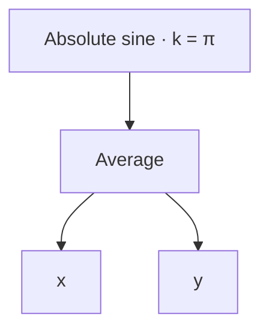
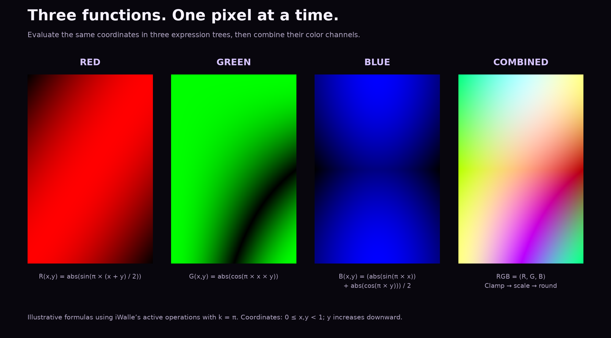
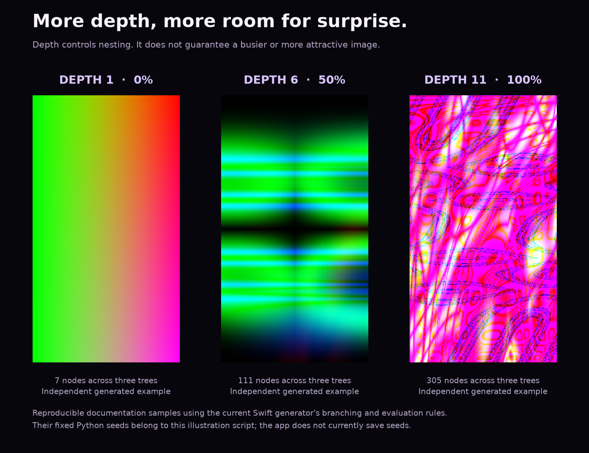

# The algorithm: expressions become pixels

[Back to the README](../README.md) · [Architecture](architecture.md) · [Development](development.md)

iWalle's image generator can be understood as a tiny interpreter. It builds mathematical expressions, stores their structure as trees, and evaluates those trees for each pixel. Three evaluations give the pixel's red, green, and blue intensities.

The source of truth is [MathBinaryTree.swift](../RandomArt/DataStructures/MathBinaryTree.swift) for expression construction, evaluation, and notation, and [CanvasV.swift](../RandomArt/ViewControllers/CanvasV.swift) for coordinates and image output. This guide describes that implementation, including details that differ from other Random Art projects.

## 1. Coordinates describe a location

For a bitmap with width `W` and height `H`, the renderer visits integer columns `0 ... W−1` and rows `0 ... H−1`:

```text
x = Float(column) / Float(W)
y = Float(row) / Float(H)
```

The upper-left pixel samples `(0, 0)`. Moving right increases `x`; moving down increases `y`. Both coordinates lie in **[0, 1)**: the final sample is slightly below 1 because the denominator is the dimension, not `dimension − 1`.

This normalized domain allows the same functions to be sampled at different resolutions. A larger render evaluates more positions within the same domain. It does not stretch a saved low-resolution screenshot.

## 2. A tree stores an expression

The leaves contain coordinates such as `x` or `y`. An internal node contains an operation. Binary operations have two children; unary operations use the right child. Each node recursively evaluates its children, combines their values, and returns one number.

For example, this tree expresses `abs(sin(π × (x + y) / 2))`:



At each coordinate, Average returns `(x + y) / 2`. The parent then applies `abs(sin(π × value))`. A tree is useful because it preserves grouping and supports both evaluation and a readable formula without parsing a string.

The Swift `MathOperation` enum makes the supported operations explicit. Exhaustive switches connect an operation to its evaluation and display behavior. A spelling mistake cannot quietly turn into an unrecognized operation string.

## 3. Build three random trees

`WallpaperEquations` creates one `MathBinaryTree` for each RGB channel. The active random-operation list is:

| Operation | Arity | Evaluation |
| --- | --- | --- |
| Multiply | Binary | `a × b` |
| Average | Binary | `(a + b) / 2` |
| Sine | Unary | `abs(sin(k × a))` |
| Cosine | Unary | `abs(cos(k × a))` |

`k` depends on the **configured depth of the entire tree**:

```text
k = π/2    when the tree's configured depth is 1
k = π      otherwise
```

That same `k` is used by every active sine/cosine node in the tree. It is not recalculated from each node's distance to a leaf. Angles are in radians.

Construction follows these rules:

1. Choose an operation for the current node from the four active cases.
2. If one operation level remains, a binary node receives `x` on its left and `y` on its right; a unary node receives a randomly selected `x` or `y` on its right.
3. Otherwise, generate a right expression with one fewer level. For a binary operation, also generate a left expression with one fewer level.

Thus depth counts **operation levels**, with coordinate leaves underneath. Depth 1 is not a bare coordinate: it still contains one operation. Unary branches make different trees have different node counts at the same depth.

The generator does not currently retain a random seed. Once created, a tree returns the same result for the same coordinates, but tapping Generate constructs new trees.

## 4. Combine the channels



The figure uses these deliberately chosen expressions with `k = π`:

```text
R(x,y) = abs(sin(π × (x + y) / 2))
G(x,y) = abs(cos(π × x × y))
B(x,y) = (abs(sin(π × x)) + abs(cos(π × y))) / 2
```

They illustrate the active operations; they are not presented as the exact output of a recorded app seed. The figure script uses the same coordinate domain and byte conversion as the app.

### One pixel, worked through

At `(x, y) = (0.25, 0.50)`:

| Channel | Evaluation | Approximate value | 8-bit result |
| --- | --- | --- | --- |
| Red | `abs(sin(π × 0.375))` | 0.923880 | 236 |
| Green | `abs(cos(π × 0.125))` | 0.923880 | 236 |
| Blue | `(abs(sin(π × 0.25)) + abs(cos(π × 0.50))) / 2` | 0.353553 | 90 |

The resulting pixel is approximately **RGB(236, 236, 90)**, or **#ECEC5A**, a yellow-green color. Repeat this process at every coordinate and the complete image appears.

For each channel, the renderer computes:

```text
byte(value) = round(255 × min(1, max(0, value)))
```

It writes RGBA bytes with alpha fixed at 255, then creates a `CGImage` through a `CGContext`. The active operators remain within `[0, 1]` for finite inputs in that range: products and averages stay in range, and absolute sine/cosine lie between 0 and 1. The final clamp protects channel conversion but is not a substitute for checking an experimental operation's domain.

## 5. Depth, visual complexity, and cost

The slider ranges from **1 to 11**, initially **6**. The visible percentage is `(sliderValue − 1) / 10 × 100`; the tree depth is `Int(sliderValue)`. This is a control for recursive nesting, not a measured percentage of image detail.



These are separate illustrative samples. They use fixed seeds in the Python documentation script so the figures can be rebuilt; those seeds are not app replay codes. An extra operation can add oscillation, suppress variation, or compress values into a narrow range. A deeper tree may therefore produce either intricate structure or a nearly uniform image.

If the three trees contain `N` nodes altogether and the bitmap contains `P = W × H` pixels, the current renderer does approximately **O(P × N)** work and allocates an **O(P)** pixel buffer. Evaluation uses a recursion stack proportional to depth. At depth `d`, one tree ranges from `d + 1` nodes for an all-unary chain to `2^(d + 1) − 1` nodes for a fully binary tree, including leaves. The selected mix determines actual cost.

For depth 11, the theoretical fully binary upper bound is 4095 nodes per tree. This explains why depth and output dimensions both matter. Keeping the loop on a background queue preserves UI responsiveness; it does not make the calculations free.

## Preview, export, and the formula sheet

The preview is sampled at the ceiling of the canvas's width and height in points. Export evaluates the **same stored equations** again at width **1170 pixels**, with height `round(1170 × canvasHeight / canvasWidth)`. Both renders use normalized coordinates. They describe the same composition, though different sample grids can show fine patterns differently.

The displayed formula strings are generated from the same three trees and cached alongside them. Opening the formula sheet does not randomize anything. Changing the slider only affects the next generation; a failed generation preserves the last successful wallpaper and its formulas.

The formula sheet includes parentheses to preserve grouping, `abs` for absolute value, `×` for multiplication, and `π` for the trigonometric scale. RGB tabs show each expression, while Copy formulas exports all three as text. The bundled gallery is a collection of image assets and metadata; its original expression trees were not stored, so the app cannot recover those formulas from the images.

Studio shading and controls are UI layers above the canvas. They never enter the exported pixel buffer. Read the [architecture guide](architecture.md) for queue ownership, display completion, and save-state handling.

## Supported experimental operations

The enum/evaluator supports additional cases that **are not in `generatedOperations`**. These preserve experiments in the project; their names should not be treated as mathematical definitions.

| Case | Current evaluator behavior |
| --- | --- |
| `divide` | If `b == 0`, return `a`; otherwise if `a == 0`, return `b`; otherwise return `min(a,b) / max(a,b)`. This is a special ratio, not general `a / b`. |
| `tangent` | `abs(tan(π × a / 4))` |
| `sineTwoPi`, `cosineTwoPi` | `abs(sin(2π × a))`, `abs(cos(2π × a))` |
| `complement` | `abs(1 − a)` |
| `circle` | `sqrt(1 + sqrt(a))` |
| `square` | `sqrt(a)`—the existing case name does not mean squaring. |
| `floor` | `Float(Int(abs(1000 × a))) / 1000` |
| `ceiling` | Return 1 if `a >= 1`; otherwise `Float(Int(1000 × a) + 1) / 1000`. It steps upward even at an exact thousandth. |

The formula formatter describes these behaviors, with helper definitions where ordinary notation would mislead. Some operations can leave `[0, 1]`, and unsafe compositions can produce non-finite results or invalid integer conversions. Before adding an operation to the random list, review its complete domain and compositions, update its arity/evaluator/formatter together, and add focused checks. The [development guide](development.md#where-to-make-changes) gives the code locations.

## History and implementation differences

Ronald remembers translating a professor's exercise into this app. The exact course handout or source has not been identified. The references below establish related ideas and teaching material, not a verified chain of authorship for his class.

**Expression-based graphics and evolution.** Karl Sims's [1991 SIGGRAPH paper, *Artificial Evolution for Computer Graphics*](https://www.karlsims.com/papers/siggraph91-backup.html), explored symbolic expressions that create images, with evolutionary variation and selection. His [*Genetic Images* installation (1993)](https://www.karlsims.com/genetic-images.html) let visitors select pictures for subsequent generations. iWalle shares expression-based image synthesis, while generating independent random trees without breeding or fitness selection.

**Random Art as a programming exercise.** [UCSD's Fall 2005 CSE 130 assignment](https://cseweb.ucsd.edu/classes/fa05/cse130/pa1/pa1.html) includes recursive expressions using coordinates, multiplication, average, sine, and cosine. [Christopher A. Stone's 2009 Nifty Assignment](https://nifty.stanford.edu/2009/stone-random-art/) teaches a closely related RGB construction and explicitly credits Andrej Bauer's Random Art as inspiration. These are strong matches to the kind of exercise Ronald describes, though neither proves where his assignment came from.

**Bauer's generator and explanation.** [Random-Art.org's about page](https://www.random-art.org/about/) describes Andrej Bauer's generator using a name to seed randomness and representing expressions as a directed acyclic graph. His [2010 Python tutorial](https://math.andrej.com/2010/04/21/random-art-in-python/) explains a simpler expression-tree approach suitable for learning. A graph may share expression nodes; this Swift implementation constructs three separate trees.

| Detail | Related teaching/generator versions | iWalle today |
| --- | --- | --- |
| Coordinate and color domain | Stone's and UCSD's exercises use a signed `[-1, 1]` domain. | Coordinates `[0, 1)`; active outputs `[0, 1]`. |
| Trigonometry | The cited assignments use sine/cosine of a π-scaled expression. | Absolute sine/cosine; the whole-tree depth selects `π/2` or `π`. |
| Reproducibility | Bauer's named generator uses its input name as a seed. | Random trees are not persisted; the display name is assigned afterward. |
| Evolution | Sims's work includes selection and evolutionary variation. | Independent random generation; no evolutionary loop. |

This connection is valuable for learning: one small project brings together recursion, trees, interpreters, sampling, color, concurrency, and interface state. The visible result makes each concept something you can inspect and experiment with.

## Rebuild the illustrations

The two educational figures are generated by [render_doc_illustrations.py](../scripts/render_doc_illustrations.py). They are original explanatory images, not copies from historical sites. To regenerate them in an optional Python environment:

```sh
python3 -m venv /tmp/iwalle-docs-venv
source /tmp/iwalle-docs-venv/bin/activate
python -m pip install numpy matplotlib
python scripts/render_doc_illustrations.py
```

NumPy and Matplotlib are documentation dependencies only. They are not needed to build or run the iOS application. Python's random stream differs from Swift's; the script reproduces the branching and evaluation rules, not an identical cross-language random sequence.
